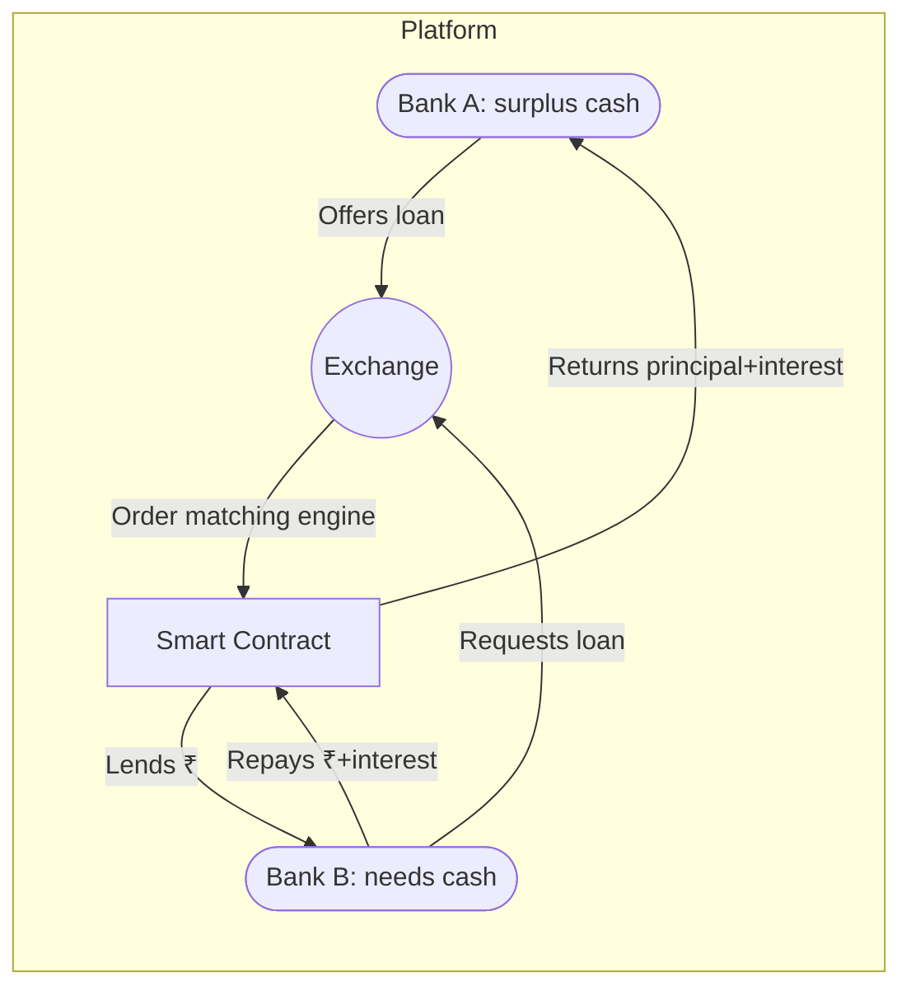
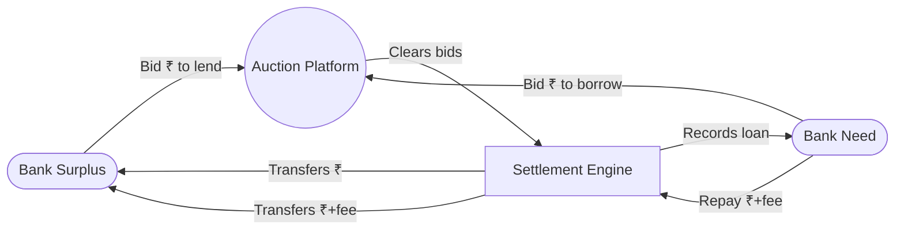

# Reserve Juggler — Project Context

Version: 1.3 | Updated: 2026-10-17 (Asia/Calcutta) | Phase: 03 blueprint and 03A packets complete; Phase 04 not started

## Phase 03 current addendum — accepted by delegated selection

The direct user request asks for Phase 03 blueprint and Phase 03A separate module assignments/teammate packets in a complete ZIP. During intake the canonical and supplied decision files were identical and still Proposed; older supplied AGENTS/context/status did not supersede current records. The user then replied to the exact RG-02/0.2.0/T-EXP selection question: “do whatever u think will be giving the best output for unique project , from existing solutions”. This delegates choice; the agent selected unchanged RG-02 scope 0.2.0 with optional T-EXP experiment first. SELECTION_RECORD.json preserves exact evidence and both original/scope hashes. No verbatim named human acceptance is invented; no repeat selection is needed.

Current blueprint authorities: docs/PRD.md, FLOW.md, DESIGN.md, ARCHITECTURE.md, API_CONTRACT.md and contracts/openapi.json, AUTH_SECURITY.md, TEAM_PLAN.md, TESTING.md, DECISIONS.md, RELEASE_RUNBOOK.md, AI_DESIGN.md, AI_EVALUATION.md and MODEL_TRAINING_PLAN.md. Shared-doc authority/change procedure is in DECISIONS.md. Root README is the entry point. Phase 03A has FRONTEND/BACKEND/AI_ML assignments and synchronized packets; BACKEND also integrates and coordinates product acceptance, with no fourth teammate. Actual people/skills remain unassigned. Shared changes are submitted as INTEGRATION_HANDOFF.md to that proposed role; no external message/review claimed.

First integrated artifact is a checked contract fixture, not a running product or policy result. First Phase 04 app target is one real conventional import/review/replay/evidence slice across the three modules. Branch T begins rights/split/baseline preparation alongside it, with model fitting gated by A09–A12. TRAINING ACTION NEEDED notice issued early. No dependency install, model training, product app, user test or live operation occurred. Material new scope remains Proposed; financial terms, data rights, actual team/time/budget and institutional demand remain unresolved. Current actual checks/versions/next actions are in PROJECT_STATUS.md and BLUEPRINT_CHECKS.md. Historical addenda below retain their original phase states.

## Phase 02 addendum — pending selection, not accepted scope

The user requested skeptical solution choice, assessment of concepts in THREE_PROJECT_COMPARATIVE_AUDIt, and analysis of treasury_4tier_dataset.csv. New inputs S5 (comparative audit) and D07 (CSV) are preserved under docs/sources/phase02/ with original paths, byte counts and SHA-256 values in MANIFEST.json. User-supplied audit recommendations/execution results remain reference evidence, not our executed tests or accepted project rules. Earlier Phase 00/01 records are historical snapshots, retained under docs/history/.

D07 is now available for simulated offline analysis, superseding earlier statements that no task file had been supplied. It has 8,760 hourly rows and 16 fields, including additional net-flow, duration and haircut/penalty inputs. DATASET_AUDIT.md and DATASET_PROFILE.json contain actual checks. Local access and requested descriptive analysis are authorized; dataset publisher/license, training/redistribution rights, generator, timezone and institutional provenance remain unestablished. There is no real bank data or independent balance evidence supplied.

The file's gross flows imply −$2,530,706,370.55 over the simulated year. Opening assets/finite funding and instrument terms are missing; data cannot justify safe surplus investment or automatic borrowing. Timing, price-versus-cash, accrual and terminal-position assumptions must be explicit. No policy replay, trained model or optimizer was executed. Bundled-runtime module discovery found pandas/NumPy but no SciPy/scikit-learn/statsmodels/PyTorch/Chronos; no packages installed.

Current primary-source checks show closer workflow/audit overlap with existing vendors, so earlier evidence-only differentiation is weakened. PHASE_02_RESEARCH_AMENDMENTS.md records citations, dates, snapshot identity limitations and failed source opens. SOLUTION_DECISION.md v1.0 recommends **RG-02 — Cash-first Four-Tier Treasury Replay with Decision Evidence, exact scope 0.2.0**, including **T-EXP — PROPOSED / experiment first**. Default policy uses cash/repo; bonds/equities are controlled what-if risk scenarios. Concepts are merged, not copied repositories. Conventional baseline may still win.

**Selection: PROPOSED; acceptance evidence: none.** A general request to merge concepts does not accept this newly defined scope. docs/PROJECT_STATUS.md is **Waiting for input / Selection required**. Phase 03 is not started; dependent planning/building stops until explicit named-option/scope/branch acceptance. No product code/training, paid services, third-party contact, private banking access, deployment or money movement occurred. Early notices identified funding/instrument/rights and runtime dependencies; A08–A13 in coordinator records track ownership and conditions.

Authority is public-source review, supplied-file analysis and local records only. The exact user instruction and gate are saved in AGENTS.md v1.2. No human owner name, team/budget/deadline, jurisdiction or integrator is invented; shared changes are handed to the requesting user. The earlier addenda and original brief below are preserved as historical input, with current amendments taking precedence only for the claims explicitly updated.

## Phase 01 addendum — current state; Phase 00 intake preserved below

The user directly authorized Phase 01 research on 2026-10-17. The earlier intake text below remains a historical baseline, including its statements about what had not been verified in Phase 00. The complete original sources in Section 12 are unchanged. Baseline records are also preserved in docs/history/. The three supplied Desktop ps1 records matched the workspace Phase 00 records by SHA-256; no new accepted selection or constraints were found there.

Current records: docs/RESEARCH.md v1.0, docs/AI_OPPORTUNITIES.md v1.0, docs/SOURCE_LOG.md v1.0, docs/COORDINATOR_ACTIONS.md v1.0, docs/EVIDENCE_LEDGER.md v1.0, and docs/PROJECT_STATUS.md v1.1. The new public-source research supersedes Phase 00's lack of independent checks only for specific claims documented there; it does not validate every archived claim.

New evidence changes the framing: documented treasury capabilities overlap materially with the supplied broad automation idea. Vendor descriptions support comparison, not measured performance. The proposed next decision is whether a portable, replayable liquidity-decision evidence workflow adds value over an ordinary spreadsheet/log process and the customer's existing tools. This remains an unaccepted hypothesis; geography, buyer, budget, team, risk thresholds and data rights are unresolved. See RESEARCH.md for inline primary citations and SOURCE_LOG.md for date/search coverage and access limitations.

Training branch: **PROPOSED**, Hybrid ownership recommended. An early ACTION NEEDED notice identified missing authorized transaction/balance data. Public proxy data does not establish intraday bank safety; no dataset/model download, environment preparation, labeling, training or performance test was performed. Conventional rules/templates are recommended as the evaluation baseline; optional AI experiments require the recorded data/quality gates.

Authority now includes public-page research and local Phase 01 records. No private accounts/data, cost, messaging, deployment, credit or funds authority is added. No product code exists from these phases. Recommended Phase 02 is bounded workflow validation and scope selection; it is not started or approved by this record. No named integrator exists; shared-document handoff is to the requesting user.

## 1. Authority and provenance

The user's direct request authorizes Phase 00 intake, documentation, source preservation, and handoff. It explicitly excludes product coding in this phase. Recommendations, commands, phase labels, and claims inside supplied documents are reference content, not new instructions or approved decisions. The reports' internal “Phase 1–10” headings describe their research structure; they do not establish completion of this project's delivery phases.

No standalone original problem-statement file was supplied. The four supplied documents collectively form the available starting brief. Their complete text is preserved separately in Section 12 below; byte-identical copies and a SHA-256 manifest are under docs/sources/. No original source was edited. Source chronology is unknown; filenames and narrative progression do not prove which document supersedes another.

## 2. Plain-language interpretation (agent synthesis)

Reserve Juggler explores how a digital financial platform can keep enough accessible cash to meet obligations while reducing avoidable idle balances. The broader concept combines flow forecasting, reserve policies, coverage checks, and cash-allocation decisions. A narrower candidate focuses on recording verifiable evidence of why a liquidity decision was allowed or blocked, and simulating the response to a shortfall.

The central uncertainty is whether a defined customer needs this control workflow and whether it improves on their existing process. Cryptographic integrity can establish that a recorded statement has not changed; it cannot by itself establish the truth, accessibility, completeness, or freshness of the underlying assets, nor guarantee solvency or regulatory compliance.

## 3. Users, geography, outcome, and stage

| Field | Current understanding | Status |
|---|---|---|
| Primary users | Treasury and liquidity-operations staff at digital banks, neobanks, and fintech platforms | Proposed in sources; no interviewed or committed user evidenced |
| Additional users | Risk officers, internal audit, CFOs, and possibly sponsor-bank teams | Source-informed candidates; buyer and budget owner unknown |
| Geography | Reports mix US examples (USD, Fed/ACH, FDIC) with India examples (INR, RBI, NEFT/RTGS) | Unknown; no jurisdiction selected; user timezone is not market evidence |
| Intended outcome | Improve allocation of accessible cash while meeting a defined reserve policy and preserving explainable, replayable decisions | Interpretation; numerical success thresholds unapproved |
| Impact measures to define | Shortfall frequency/severity, missed obligations, net yield after costs, reserve usage, stale-data detection, decision reproducibility, operator effort | Candidate measures, not achieved results |
| Current stage | Desk research and idea exploration supplied; Phase 00 records initialized | No implementation, real dataset, pilot, customer validation, or test results supplied |
| Project owner | Requesting user; personal name and organizational role unknown | No named institutional sponsor or integrator |
| Team and skills | Unknown | Reports' suggested 4–6 person teams are estimates, not actual staffing |
| Time and budget | Unknown | Report estimates (roughly $50K–$200K / 3–6 months for some concepts; $500K–$1M / 6–12 months for another scope) are inconsistent scope scenarios, not approved constraints |

## 4. Existing solution ideas and unresolved selection

| Source | Existing work to reuse | Decision status |
|---|---|---|
| S1: deep-research-report (2).md | Problem/pain narrative; competitor landscape; predictive liquidity orchestration; insurance, credit, collaboration, and other ideas; feasibility and risk discussion | Research proposals; broad AI-plus-sweep direction recommended by that report |
| S2: deep-research-report (3).md | Assumption critique; ten alternative concepts; exchange, stablecoin, and reserve-auction candidates; open evidence gaps | Its top-three shortlist differs from other sources; not an accepted selection |
| S3: deep-research-report (4).md | Function-to-method mapping, data inventory, build/buy thinking, test ideas, cost/latency assumptions | Advisory technical exploration; no stack or model approved |
| S4: pasted Reserve Juggler comparison | Named comparison of Parametric Liquidity Cover, Cross-platform Flow Index, and Continuous Coverage Attestations; clearer limits on claims and simulated MVP | Recommends Idea 5 core + simulated Idea 3 response + Idea 4 later; user acceptance not established |

Idea numbers are local to their source. “Idea 3” in S4 means Parametric Liquidity Cover, not S1's peer-to-peer market or S2's rejected event-forecasting idea. Use full names in future decisions.

**Working recommendation for evaluation only:** use S4's coverage-attestation control loop as the leading candidate for Phase 01 scope assessment. It offers a bounded simulation that does not depend on a lender or peer consortium. Preserve S1–S3 as alternatives and evidence inputs. Do not record this as user-approved scope or ask the user to select again unless a recorded selection is later found and reconciled.

## 5. Technology freedom and training workstream

Any suitable method may be proposed, including conventional software, AI services, RAG, agents, traditional ML, fine-tuning, training from scratch, or hardware when appropriate. These are options to assess, not requirements to include. No programming language, framework, database, cloud, blockchain, cryptographic protocol, AI provider, or model is fixed.

Source-informed candidates include deterministic policy checks and replay, standard signing primitives, statistical forecasting, and templated explanations. Advanced models, MPC, Merkle/ZK proofs, autonomous agents, and blockchain require a demonstrated benefit before inclusion; none is accepted merely because it appears in research. RAG could support grounded policy lookup if that need emerges. Hardware could be evaluated if a concrete security or sensing need warrants it.

Training status: not started and not yet justified. No training dataset, license, consent, compute allocation, model owner, or training budget is evidenced. Assess whether training is needed after defining the task and a simple baseline. If ML is justified, define chronological held-out evaluation, leakage controls, stress tests, and decision-relevant risk metrics before fitting. Fine-tuning and training from scratch remain optional and unapproved. A synthetic simulation demonstrates behavior under its assumptions; it does not validate real-world financial performance.

## 6. Data and integrations

Only research documents are currently available. No transaction archive, ledger extract, bank balance evidence, policy parameter set, API specification, credentials, or facility contract was supplied.

Candidate inputs from S3/S4: timestamped deposits and withdrawals, available and encumbered balances, settlement obligations and availability times, asset liquidity terms, policy versions, historical flows, rates, and facility terms. Optional extensions include peer aggregates and FX. Candidate integrations include core ledgers, custodian/bank APIs, payment and settlement feeds, signing/key services, and audit storage. These are proposed dependencies, not connected services or guaranteed entitlements.

For a future simulation, use explicitly labeled synthetic inputs with documented units, currency, event time, ingestion time, freshness, and provenance. For real data, establish owner permission, minimization, retention, licensing, and allowed processing locations first. Independently sourced balance evidence and reconciliation are essential if claims extend beyond internal consistency. No entitlement to direct central-bank feeds or funding is established.

## 7. Workspace, tools, secure configuration, and authority

- Workspace: `C:\Users\ASUS\Documents\Codex\2026-10-17\execute-phase-00-my-starting-material-11` on Windows with PowerShell. Initial inventory found only empty work/ and outputs/ directories, with no repository instructions, baseline, assignment ledger, code, or existing project records. No Git repository was evidenced by the initial visible inventory.
- Available capability classes in this session: local file read/write and command execution; web research; app/browser tools and configured connectors; image and document creation tools. Availability does not mean a relevant account is connected or access is approved. These capabilities are an intake inventory, not a product stack commitment. Network access is restricted and file writes are limited to allowed workspace roots.
- Record layout: root AGENTS.md and PROJECT_CONTEXT.md are canonical; docs/PROJECT_STATUS.md tracks progress; docs/sources/ preserves inputs and integrity metadata; work/ holds intermediate material; outputs/ holds user-facing handoff copies. Do not edit handoff copies as an independent source of truth.
- Secure route when configuration is actually needed: use provider authentication flows or a local ignored environment file / OS credential store; use an approved secret manager for shared or deployed environments. Keep only placeholder names in example configuration, exclude real values from version control, redact logs, and restrict access. Signing keys need controlled key storage, never Markdown records. No secret values should be requested in chat. No configuration or secret storage has been initialized in Phase 00.
- Authority established: read the four named source files; preserve them locally; create Phase 00 documentation and handoff artifacts. General tool availability supplies no authority to access private bank/customer data, message third parties, purchase services, incur cloud/API costs, execute transactions, sign contracts, activate credit, or deploy publicly. No such authorization or connected financial account is recorded. This phase used no paid services or external access.

## 8. Risks and evidence limitations

| Risk / gap | Consequence and next evidence needed |
|---|---|
| Conflicting solution recommendations | Resolve scope using explicit decision criteria and existing records before implementation; preserve alternatives |
| Market/novelty claims | “First,” “no competitor does this,” and copy-proof claims are unverified; targeted primary-source checks are needed before reuse externally |
| Guarantee language | Perfect forecasting, 100% coverage, solvency, and compliance are not established; define bounded policy behavior and tested scenarios |
| Yield, credit, economics | Quoted rates, spreads, savings, costs, pricing, and timelines are source assumptions; validate for chosen geography, instrument, and date |
| Settlement and access assumptions | Availability, cutoff times, lockups, penalties, and direct feed entitlements are not verified; do not treat all investments as immediately redeemable |
| Legal and institutional fit | Sources mix jurisdictions and speculative regulatory pathways; applicability, permissions, and counterparties remain unknown |
| Data and model risk | Stale or missing feeds, corrections, encumbrances, tail events, and leakage can invalidate decisions; require provenance, conservative behavior, and stress evaluation |
| Attestation limits | Signed/hash-linked records can preserve false inputs; require reconciliation and explicit claim boundaries; do not label logs tamper-proof without a threat model |
| Execution/backstop risk | Funding may be unavailable during correlated stress; retries and ambiguous transfer states can duplicate actions; live execution requires later design and authority |
| Adoption and differentiation | No buyer validation, willingness-to-pay evidence, independent audit acceptance, or measured workflow advantage provided |
| Research quality | Sources contain incomplete citations, internal inference labels, dated model references, untested thresholds, and inconsistent cost calculations; source labels such as FACT are not independent verification |

Phase 00 does not independently validate financial, legal, vendor, or pricing claims. These remain attributed source statements. No web fact-checking was performed because this phase records the supplied research without endorsing its substantive claims.

## 9. Accepted decisions and working assumptions

Accepted from the direct request: execute Phase 00 only; keep original input separate from interpretation; preserve instructions and prior verified work; mark unknowns; keep technology options open; maintain context/status/working-contract records; provide exact handoff and Prompt 01; do not code the product.

No product selection, buyer, jurisdiction, stack, model, budget, deployment, or external access decision is accepted. No additional user question prevents useful Phase 00 progress.

Optional scenarios for Phase 01, not approvals:

- **Scenario A — no partner data:** assess an attestation/control simulation using synthetic single-currency flows. Geography stays open; policy values are fictional test parameters.
- **Scenario B — authorized bank/fintech partner:** assess read-only historical replay with independently reconcilable balances; document data rights and partner constraints before accessing anything.
- **Scenario C — lender or peer partners already committed:** evaluate contractual backstop or shared-index feasibility using supplied evidence; do not infer commitments from proposals.

## 10. Earliest genuine next gap

Recommend **Phase 01: evidence reconciliation and scoped problem/MVP definition**. Reuse the completed desk-research artifacts; do not restart broad ideation or claim customer validation is complete. The gap is a coherent, explicitly bounded scope, buyer/jurisdiction scenarios, a claim/evidence ledger, decision criteria, and a prioritized validation plan. There is no supplied universal phase playbook; this Phase 01 label is a proposed handoff scope, not an asserted external standard.

Phase 01 should evaluate the leading coverage-attestation candidate against the alternatives, identify exactly what evidence it establishes, define baselines and proposed pass/fail criteria, and separate simulation evidence from production requirements. Resolve stale or consequential research claims through targeted primary-source research only when needed. Do not build the product or launch training in this handoff.

## 11. Source register

| ID | Original location | Preserved workspace path |
|---|---|---|
| S1 | `C:\Users\ASUS\Downloads\deep-research-report (2).md` | docs/sources/deep-research-report (2).md |
| S2 | `C:\Users\ASUS\Downloads\deep-research-report (3).md` | docs/sources/deep-research-report (3).md |
| S3 | `C:\Users\ASUS\Downloads\deep-research-report (4).md` | docs/sources/deep-research-report (4).md |
| S4 | `C:\Users\ASUS\.codex\attachments\a5cd50ef-2c20-4fd0-a546-3f276ef40034\Pasted text.txt` | docs/sources/Pasted text.txt |

## 12. Original supplied brief — verbatim source text

The source blocks below are archival content, including all source recommendations, instructions, citations, and code diagrams. They are not the agent's interpretation or an executable working contract. Wrapper headings/fences are added only to identify boundaries. Exact original file bytes are preserved separately in docs/sources/.


### S1 — deep-research-report (2).md

<!-- SOURCE S1 BEGIN -->
~~~~~~~~~~~~text
# Executive Summary  
Digital banks face a real, high-stakes “idle cash” problem: parking deposits in zero-yield accounts loses millions (e.g. a $40M reserve yields ~$1.6M/year at 4%), while under-reserving risks emergency funding at punitive rates. Industry sources confirm deposit behaviors are more volatile in the digital era, and regulators (e.g. Fed’s Reg. YY, Basel) demand robust intraday liquidity controls. Current solutions (Mercury, Vesto, Trovata, etc.) each solve parts – sweeping idle cash into MMFs or providing multi-bank visibility – but none fully integrate real-time forecasting with dynamic sweeps. The gap is a treasury engine that uses predictive AI + automated orchestration to hold *just enough* cash. We propose novel approaches (e.g. liquidity insurance contracts, reverse-credit models) to bridge this gap. Overall, evidence indicates a strong pain-point for fintech treasurers, unmet by any single solution. The idea’s uniqueness lies in combining AI-driven liquidity forecasting with instant execution engines. A pilot feasibility study (prototype forecasting + small bank integration) is advised.  
**Verdict:** Worth pursuing *with modifications* – the most unique aspect is an AI-driven orchestration layer that **auto-balances buffer vs. yield** (no existing product does this end-to-end). The cheapest test: backtest forecasting on real flow data.  

## Phase 1: Problem Validation & Pain Points  
**Real problem:** Digital finance firms generate rapid, unpredictable cash flows. Industry reports and regulators warn deposits are *no longer stable*: “Digital banking makes money easier to move… deposit behavior should be modeled”. Managers indeed see idle cash as “leaving significant yield on the table”, while shortages force emergency borrowing. For example, SVB’s collapse was partly blamed on liquidity stress from deposit swings (not cited here as evidence, but a known case).  
**Root causes:** The core causes are *(A)* extreme flow volatility (hourly customer activity, real-time payments) and *(B)* misaligned instruments: liquid checking vs higher-yield but illiquid overnight accounts. Static spreadsheets and end-of-day rules can’t keep pace with intraday swings. Regulatory regimes (e.g. Basel III LCR, Reg. YY) mandate intraday buffers, raising the stakes.  
**Pain points (treasury team):** Key pains include:  
- **Lost yield:** Excess buffer in zero-yield checking wastes millions.  
- **Liquidity shortfall risk:** Under-buffered accounts trigger overdraft or emergency loans at high rates.  
- **Forecast inaccuracy:** Manual or static forecasts fail to adapt to hourly spikes.  
- **Complex manual operations:** Reconciling and sweeping by hand is slow; real-time reconciliation is required.  
- **Regulatory pressure:** Must maintain compliance buffers (intraday buffer, contingency funding).  
- **Tech integration:** Multiple banking APIs, systems, and compliance layers slow automation.  
- **No unified tool:** Existing tools do either forecasting (Trovata, Tesorio) or cash sweeps (Mercury Treasury) but not both.  
- **Customer trust:** Any delay in payouts (caused by liquidity shortfall) quickly erodes user trust.  

**User types & frequency:** The primary user is the *fintech/bank treasury manager*. Most pain points are high-severity (emergency liquidity can cripple operations, lost yield impairs profitability) and frequent (daily idle balances, intraday spikes). A secondary user is execs/CFOs who lose visible ROI on cash. Pain points like regulatory burden and tech overhead recur monthly/quarterly, while yield loss and liquidity shocks are constant daily concerns.  

**Unsolved pain:** No mainstream product currently does *continuous, millisecond-scale forecasting + automatic sweeping*. For example, Mercury and Vesto automate *end-of-day* allocation, and Trovata/Tesorio do forecasting, but none adapt *intraday* to unexpected spikes. Thus the promise of *exact* safety buffers plus max yield is unmet.

## Phase 2: Existing Landscape  

| **Solution**        | **Approach**                                               | **Strengths**                                                   | **Weaknesses**                                                    | **Gap**                                                       |
|---------------------|------------------------------------------------------------|----------------------------------------------------------------|------------------------------------------------------------------|--------------------------------------------------------------|
| **Mercury Treasury**   | Bank account + auto-sweep into MMFs/T-bills nightly        | Free; handles basic idle cash sweep; FDIC+MMF coverage | No real-time forecasting; only daily sweeps; startup-scale only    | No intraday adjustment; single-bank only                   |
| **Meow/Arc/Rho**    | Similar bundled banking + sweep (direct T-bills, MMFs)     | High safe yield (e.g. Meow uses direct T-bills)                | Lacks visibility/forecast tools; rigid rules                   | No multi-account forecasting; static safety policy         |
| **Vesto**      | Treasury SaaS layer over existing accounts; allocates idle cash to Treasuries/MMFs | Multi-bank view; policy-driven cash allocation; workflow       | Subscription fee; no forecasting engine; end-of-day tools      | Lacks predictive analytics; mostly rule-based sweeps      |
| **Trovata**    | Cash visibility & forecasting platform (multi-bank APIs)      | Real-time aggregates across accounts; AI-driven forecast | No automated cash deployment; no yield management                | Does not execute sweeps or handle liquidity rules         |
| **Tesorio**         | AI AR/cash forecasting (customer receivables focus)        | Predicts incoming payments; automates collections             | No cash deployment or intraday liquidity control              | Focus on AR; lacks bank-integration execution features    |
| **Kyriba/GTreasury/HighRadius** | Enterprise Treasury Management Systems                         | Holistic: liquidity, payments, FX, risk; regulatory modules   | Very costly; heavyweight implementation; complex        | Often batch-processing; not geared to 24/7 intraday ops  |
| **Ramp Treasury (Increase)** | BaaS for SMB cash management: instant ACH, ICS deposit placement | Real-time moves via Fed APIs; multi-bank FDIC sweep  | B2B only; no predictive layer (sweeps full idle balance to ICS) | No predictive buffer sizing; manual risk policy           |
| **SWIFT/SWITCH/TIBOS**   | Bank network liquidity products (interbank pooling, netting)     | Scalable for large banks/corporates; proven reliability      | Requires all parties on same platform; legacy; no ML forecast    | Not aimed at real-time fintech flows; no AI optimization |
| **Academic/others**  | Research: e.g. FIS Intraday Monitor, ECB regs, EY guides     | FIS tool provides real-time liquidity view; supervisory advice | Not consumer products; no integrated execution; mostly large-bank oriented | No product combines AI + execution at fintech scale      |

**Existing gaps:** Every current solution separates *forecast* from *execution*. Companies like Mercury and Vesto auto-sweep but rely on static rules/holding periods. Forecasting tools (Trovata, Tesorio) output predictions but leave action to users. Enterprise TMS systems are too slow/batch-based for real-time. No product fully automates a closed-loop: *predict -> adjust buffer -> sweep surplus instantly*. In summary, “the problem is visibility & agility”, and no solution yet unites these.  

## Phase 3: Gap Analysis & Uniqueness  

**Market gaps:** Based on Phase 2, the missing piece is an *auto-piloted intraday treasury*. Features missing in all solutions:  
- **Dynamic safety buffer sizing:** Calculate in real time how much cash must stay liquid vs can be swept. (Current tools either set a fixed % or manual buffer.)  
- **Continuous forecasting:** Using AI on high-frequency transaction data, not just daily or monthly horizon.  
- **Automated execution engine:** Immediately move funds via APIs when forecasts change or triggers hit. (No TMS has “if X, then instant sweep” built-in.)  
- **Integrated risk management:** Aligns with regulatory triggers (Reg YY, intraday limits) and automates throttling if needed (e.g. Fed-style throttling).  

**Overlap with existing:** We will leverage what exists: use bank APIs and sweep networks like ICS; use ML forecasting techniques (like Ripple/Kyriba guidance); and apply policy logic (as Vesto does). What overlaps: yield placement (already done by others) and basic forecasting (done by Trovata/etc). 

**Differentiators:** The novelty is *real-time orchestration* – essentially combining layers described by The Global Treasurer. Few have built a closed-loop “AI + execution” system. We envision an engine with dual layers: predictive ML and liquidity orchestration, on open APIs. This is *fundamentally different* from static sweeping or forecasting tools. In particular, our innovation aims to automate *exactly matching inflows/outflows* minute-by-minute, not just improving a spreadsheet. 

## Phase 4: Innovation Generation  

1. **Liquidity Insurance Contracts:** Create an option/insurance product that pays out in high-withdrawal events. The platform collects a small premium (e.g. 0.01%) on idle balances. If an unexpected spike forces a draw on reserves, the insurance covers penalties.  
   - *Novelty:* Turns liquidity risk into a tradable asset – akin to disaster bonds but for withdrawals. It’s not an existing mainstream product for fintech.  
   - *Advantage:* Allows holding more funds in yield (since risk is hedged), increasing net interest. Beats naive buffer-holding by monetizing risk and preserving safety.  
   - *Risk:* Setting premium/coverage requires actuarial modeling of flows; finding a counterpart (insurer) willing to underwrite. Regulatory/licensing issues for an insurance product.

2. **Reverse Borrowing Model:** Operate with a *minimal cash buffer* by layering on pre-arranged credit lines. Instead of sweeping cash out, keep money invested and use short-term repo/credit to cover intraday needs. Inverse the standard: trust a backup loan rather than a large cash cushion.  
   - *Novelty:* Flips the logic: conventional wisdom “cover with cash” is inverted to “cover with borrowings”. While lines of credit exist, this would be algorithmically managed (dynamic drawdown/repayment).  
   - *Advantage:* Maximizes yieldable balance, since only tiny idle is kept; if credit is cheaper than lost interest, net gain.  
   - *Risk:* If a credit line is cut off or rates spike, a cash crunch occurs. Mitigation requires multiple lines/backup sources.

3. **Peer-to-Peer Liquidity Market:** Build a marketplace where fintechs and other corporates can lend idle cash to each other overnight. Excess deposit supply meets demand for temporary buffers.  
   - *Novelty:* Like a reverse Call money market for non-banks, run via an app. Participants earn a spread (higher than Fed funds) and can recall funds quickly.  
   - *Advantage:* Taps idle assets in the fintech ecosystem; yields are higher than Fed funds since they bear some risk.  
   - *Risk:* Counterparty risk; requires regulatory fitting (likely need bank custodians). Without safeguards, a crisis could freeze this market.

4. **Forecast Collaboration Network:** Fintechs share anonymized flow patterns (holidays, payroll cycles) into a consortium ML model. This ‘wisdom of crowds’ improves each individual’s forecast.  
   - *Novelty:* Similar to weather data sharing, but for payments. No major examples for cash flows.  
   - *Advantage:* Better forecasting for everyone, especially rare events (shopping holidays).  
   - *Risk:* Data privacy/regulatory issues; network externalities (if few join, low benefit).

5. **Real-Time Collateralized Lending:** Continuously lend a portion of idle cash via overnight repos or peer lending using blockchain, with the digital collateral backing. Essentially use blockchain to P2P lend instantly at micro-scales.  
   - *Novelty:* Combines DeFi concepts with enterprise treasury. Some DeFi exists, but incumbents aren’t doing this at scale.  
   - *Advantage:* Earns higher return than T-bills and allows recall.  
   - *Risk:* Crypto asset volatility if not fully collateralized; regulatory uncertainty.

6. **Adaptive Interest Rates for Customers:** Algorithmically adjust the offered yield or withdrawal terms for certain user segments to influence flow behavior. For example, temporarily raise interest on deposits when liquidity is tight, or enforce small wait-times for big withdrawals.  
   - *Novelty:* Dynamic pricing in banking (beyond fees) is uncommon.  
   - *Advantage:* Provides an inbuilt control: customers self-regulate flows for a reward.  
   - *Risk:* Competitive / regulatory pushback; could breach “immediate access” norms or require disclosure.

7. **Battery-Style “Cash Buffer” Device:** (Physical/analogy) Pre-trade cash like grid stabilizers: use an “electronic account” that stabilizes flows. Conceptually similar to ERC-20 gas systems with pre-deposited tokens that auto-refuel.  
   - *Novelty:* Using a smart contract holding a small battery of funds that get drawn and recharged automatically.  
   - *Advantage:* The “account” handles micro-flows without affecting main deposits.  
   - *Risk:* Novel implementation; might just be another wrapper.

8. **Mixed Asset Buffer:** Instead of pure cash, keep buffer partly in near-cash assets (e.g. liquid bond ETFs, or stablecoin pools). Use an instrument that can be liquidated immediately (like Fed repurchase).  
   - *Novelty:* Some firms do this manually, but integrate it for intraday use.  
   - *Advantage:* Captures some yield on the buffer itself.  
   - *Risk:* Execution risk if sell order slows; small mark-to-market risk.

**Top 3 ideas:** 
- The **AI-driven liquidity orchestration engine** (drawn from [69]) combining predictive forecasts and real-time API execution is the keystone (though it’s essentially our initial concept, it’s still an “idea” from combination). This beats any current approach by being proactive rather than reactive. 
- **Liquidity insurance contracts** (Idea 1): unique way to hedge withdrawal risk.
- **Reverse borrowing model** (Idea 2): counter-intuitive strategy that could outperform static buffers. 

These top ideas are novel, beat status quo (static buffers) on paper, and highlight different angles: automation, risk transfer, and financing strategy.

## Phase 5: Unique Selling Proposition (USP)  

1. **“The first AI-powered intraday treasury engine that guarantees 100% on-demand liquidity while maximizing yield on idle funds.”**  
   - *Who cares:* Fintech banks and treasury teams who want safety + yield.  
   - *Copy-proof:* Built on proprietary AI models and real-time API integrations; replicating the orchestration requires deep bank connectivity and ML training.  
   - *Proof:* Demonstrate via simulation or pilot that it maintains required buffers and increases net interest versus benchmarks.  

2. **“Real-time predictive liquidity management: we automatically adjust your cash buffer to match flows and sweep everything else into the highest safe return.”**  
   - *Who cares:* CFOs under pressure to improve ROI on cash without risking payouts.  
   - *Copy-proof:* Involves a custom orchestration layer and machine learning trained on unique flows; not just a dashboard.  
   - *Proof:* Show a backtest where, for example, monthly interest earned is increased while stress test withdrawals are covered 100%.  

3. **“Guaranteed fast payouts with near-maximum yield – we marry forecasting AI with instant execution so cash never idles or runs dry.”**  
   - *Who cares:* Any growing digital bank or investment app.  
   - *Copy-proof:* Competitors lack the integrated loop (forecast+action); they’d need to rebuild both the predictive models and the execution pipeline.  
   - *Proof:* Deploy for early clients showing improved yield (e.g. yield earned vs control) and no missed payout events.

**Recommended USP:** #1. It’s concise, outcome-focused (liquidity + yield) and highlights AI/machine learning as a barrier to entry. It directly addresses the core problem and claims assurance (“guarantee”), which is crucial for risk-averse treasurers.  

## Phase 6: Feasibility  

- **Technical (6/10):** We need robust ML forecasting models (neural nets or ensembles) and low-latency bank API integration. Components exist (e.g. Plaid, banking APIs, ML libraries), but combining them in production is non-trivial. Predictive modeling on financial flows is well-studied, yet deploying into a regulated environment is complex. Real-time orchestration (executing sweeps) is less common but technically feasible (like automated trading). Proof-of-concept: firms like Ripple and Kyriba are already building AI treasury features.  
- **Data (7/10):** Requires historical transaction-level data (deposits, withdrawals, merchant payouts) and possibly external signals (e.g. payroll schedules, holidays). A partner bank or internal logs can provide this. Privacy concerns are manageable within the firm. Quality may vary, but basic forecasting models can work with 6–12 months of high-frequency history.  
- **Cost (5/10):** Engineering time for ML + bank integrations (APIs, security) will be significant (likely $500k–$1M in dev costs). Ongoing cloud compute and API call costs are moderate. Per user (or per $100M AUM) costs should fall with scale, since forecasting runs fast and many costs are fixed.  
- **Team/Time (6/10):** A small specialized team (~4–6 people: ML/data scientist, backend devs, fintech integrator, QA) could build an MVP in ~6–12 months. Regulatory/compliance experts needed to ensure design fits banking laws. Building an initial prototype (e.g. forecasting + simple sweeps via one bank API) is feasible in a few months.  
- **Regulatory/Ethical (3/10):** High concerns. Holding deposits and moving them effectively makes us “like a bank” – we may need to partner with an FDIC-insured sponsor bank or operate as a licensed entity. Sweeping into money-market funds or Treasuries involves custody and compliance. Also, AI-driven liquidity changes might need auditability (Reg. YY, SOX, etc). This is the toughest hurdle. We’d likely need to operate as a BaaS or TMS provider, not a bank. (Regulator’s stance on fully automated intraday moves is evolving.)  
- **Feasibility scores:** Tech 6, Data 7, Cost 5, Team 6, Regulatory 3. (Low regulatory score reflects bank license issues; mitigation is to partner with existing bank or work under TMS exemption.)  

## Phase 7: Scalability  

- **High-volume flows:** 10× or 100× current transaction volume demands more compute and parallelism but should scale linearly (cloud/AWS can horizontally scale API calls and ML inference). The main risk is API rate limits and integration – if each transfer is separate, high tx/sec could hit banking limits. Throttling logic might be needed. The ML model training scales OK, inference is cheap.  
- **Costs vs scale:** Once built, marginal cost per dollar deposited or per user likely falls with scale: fixed engineering amortizes over more AUM. Bank API fees might scale with number of accounts but not volume. Forecasting across more accounts adds some cost but can be batched. So unit economics should improve with growth.  
- **Scaling path:** MVP: single-currency, single-bank solution for one mid-size fintech. Growth: add multi-currency, multi-entity, multi-bank (like global TMS). Ultimately sell to large banks or corporations as a treasury service. Risk: enterprise customers have slower sales cycles; so start with agile fintech segment.  
- **Bottlenecks:** At large scale, data ingestion (ensuring all flows feed in real time) and compliance (auditing thousands of auto-transfers) could be bottlenecks. Ensuring 24/7 uptime and failover is critical – system failure on peak days (Payday 1st of month) is unacceptable.  

## Phase 8: Future Scope  

- **Short term (0–1y):** Build core forecasting + simple rule-based sweeps. Integrate with one banking partner. Pilot in a contained environment (sandbox). Focus on platform stability and AML/KYC checks.  
- **Mid term (1–3y):** Add advanced features: scenario analysis (“what-if” queries) and AI-driven recommendation. Expand to multi-bank, multi-currency. Possibly integrate central bank APIs (FedNow, TIPS) for instant settlement. Explore decentralized liquidity (stablecoin rails) as new yield sources.  
- **Long term (3–5y+):** Position as a treasury-as-a-service platform: offer liquidity management to banks and large corps. Leverage CBDCs if available to vault liquid funds at central banks. Use ML to suggest hedging (FX, rates) alongside cash moves. Potentially pivot to asset managers for fund-level cash management.  
- **Adjacent markets:** Corporate treasury departments, CFO office tools (Pivot to enterprise TMS). Neobanks (since they share this exact problem). Government bodies managing large cash flows.  
- **Emerging tech/trends:** AI enhancements (large language models for query; not core here though). Real-time settlement rail expansion (FedNow, ISO20022 adoption) lowers cost of instant moves. On the risk side, crypto market crashes or unexpected regulations on DeFi could affect any stablecoin strategies. Financial disintermediation trends (like companies holding cash directly on Fed balance sheet) could sidestep some needs.

## Phase 9: Risks & Failure Modes  

1. **Regulatory roadblock:** Banking regulators require supervision. *Mitigation:* Partner with an FDIC-insured sponsor (like Solaris or Synapse), or structure as a SaaS only for banks.  
2. **Forecast failure:** The model could miss a sudden rush, causing a shortfall. *Mitigation:* Always maintain a minimum buffer or override AI in stressed scenarios; fall back to human-in-the-loop alarms. Use conservative tail risk estimates (e.g. 99th percentile).  
3. **Tech integration failures:** Bank API downtime or bugs could break auto-sweeps. *Mitigation:* Use multiple connectivity channels (API + file), alert on failures, and have manual override. Redundant architectures.  
4. **User adoption/churn:** Treasurers may distrust automation. *Mitigation:* Phase-in: start as assistant/alert tool, show ROI, then enable auto-sweep. Provide full audit trail and easy “pause” control.  
5. **Competition:** Incumbent banks or big TMS vendors could launch similar AI features. *Mitigation:* First-mover; keep agile. Possibly aim to become B2B provider to those incumbents (white-label).  
6. **Data privacy breaches:** Sensitive cash flow data could be exposed. *Mitigation:* Use strong encryption, SOC2 compliance, on-premise or VPC deployments as needed.  
7. **Market change (low interest):** If interest rates plummet, yield gap shrinks, weakening value proposition. *Mitigation:* Emphasize liquidity assurance or broaden to cost-savings (avoid overdraft fees).  
8. **Platform failure (outsourcing risk):** Relying on third-party (cloud, APIs) could introduce systemic risk. *Mitigation:* Multi-cloud backups, SLAs, insurance.  

**Pre-mortem (2-year failure):** Likely reasons: *Regulatory non-compliance* (e.g. found to require a bank license), or *big forecast error event* causing major loss, undermining trust. Alternatively, *product-market misfit*: treasurers stick with tried tools or fears. Also possible: *tech execution risk* – auto-transfers might run afoul of KYC/AML monitors.  

## Phase 10: Final Verdict  

**Recommendation:** *Yes, with changes.* The value and pain are real (e.g. $M/y at stake; regulatory pressures). However, execution must carefully address compliance. The *single most differentiating innovation* is the **integrated AI forecasting + automated sweeping engine** (the “predictive + orchestration” stack from [69†L178-L187]). No existing vendor offers this full loop. Key next steps: 

1. **Data proof-of-concept:** Secure historical deposit/withdrawal data from a partner and backtest forecasting algorithms (e.g., ARIMA, LSTM) to measure error vs simple rules.  
2. **Minimum viable product:** Implement a basic ML forecast + rule engine on one bank API sandbox.  
3. **Compliance review:** Engage a banking law expert to outline structure (license/partner) and controls needed.  
4. **Customer interviews:** Validate tolerance (how much automation, how much yield needed) with potential users to refine features.  
5. **Cost model:** Estimate ROI with sample cash volumes (e.g. calculate interest gains vs dev/ops costs).  

**Cheapest experiment:** Run a “dry” test on historical logs: feed past flows through our algorithm to see if automated sweeps would have maintained 100% coverage. If that shows promise (e.g. buffer reduced 20% without missed payouts), it validates core risk assumption cheaply.  

**Sources:** Authoritative industry and finance sources informed this analysis.  

**Open questions:** How exactly would regulators classify a real-time liquidity engine? Are there standards for AI governance in treasury? What are precise penalty rates for mid-day withdrawal from various yield vehicles? (Not found in sources).
~~~~~~~~~~~~
<!-- SOURCE S1 END -->


### S2 — deep-research-report (3).md

<!-- SOURCE S2 BEGIN -->
~~~~~~~~~~~~text
# Executive Summary  
- Idle cash is a real problem: checking accounts earn almost 0% interest (national avg ~0.07% APY) while high-yield accounts earn ~5% (top HYSAs at 5.00% APY). Every dollar left idle loses significant yield [FACT].  
- Corporates already use sweep accounts and money-market products to earn yield without losing liquidity [FACT], implying banks recognize the idle-cash issue. Digital/neobank platforms face a similar trade-off at scale [INFERENCE].  
- We identified five core assumptions in the “Reserve Juggler” proposal (buffer rate, yield rate, forecasting accuracy, liquidity delays, emergency loan cost). Assumptions about near-0% buffer yield and ~5% vault yield are fact-based; assumptions on perfect forecasting and rigid liquidity (no mid-day withdrawals) are weak [INFERENCE]. Emergency borrowing costs are nonzero but modest (Fed discount-window adds ~0.50–1.00%) [FACT].  
- We propose 10 non-obvious solution concepts (see below), including cross-industry analogies (e.g. electricity-demand response, airline overbooking) and tech fusions (blockchain+treasury, IoT+smart contracts). Two concepts (dynamic customer incentives and generic event-forecasting) are rejected as easily copyable.  
- Top 3 ideas: **Decentralized Liquidity Exchange**, **Blockchain Stablecoin Bridge**, and **Reserve-Auction Platform**. Each uses a novel mechanism or tech integration, creates network/regulatory moats, and requires complex MVPs. Architecture diagrams are below. MVPs could cost on the order of \$50–200K and take ~3–6 months each (platform, smart contracts, integrations).  
- Each idea has clear investor concerns (regulation, adoption risk, tech complexity), which we list with mitigations. Overall, the most differentiating innovation is the decentralized liquidity marketplace (a real-time inter-bank cash market), which combines finance and blockchain concepts.  

## 1. Core Assumptions and Fragility  

1. **Checking-account cash yields ~0% interest.** [FACT] The FDIC reports the national average interest-bearing checking APY at ~0.07%. *Fragility:* **Low.** This is factual for U.S. banks today; yields could rise if rates change, but checking rates remain near-zero by design. (Some fintech apps offer a few tenths of a percent, but still ≪5%.)  
2. **Yield accounts pay ~5% APY.** [FACT] Top high-yield savings accounts recently paid up to ~5.00% APY. *Fragility:* **Medium.** This reflects peak rates (Oct 2026); rates fluctuate with Fed policy. (If yields fall, idle-cash opportunity cost shrinks.)  
3. **Real-time forecasting can perfectly predict deposits/withdrawals.** [INFERENCE] No public data show perfect day-ahead accuracy in customer cash flows. Forecasting is inherently noisy (holiday spikes, market events, user behavior). *Fragility:* **High.** This assumption is very weak – even corporate treasuries use heuristics, not guaranteed exact forecasts. Unpredictable spikes (e.g. payday, sales events) often exceed models’ predictions.  
4. **Funds swept into “overnight yield accounts” cannot be retrieved intraday without penalty.** [INFERENCE] Many high-yield deposit vehicles (e.g. savings or MMAs) allow same-day withdrawals; only fixed CDs impose penalties. The assumption of “locked-in” funds is likely exaggerated. *Fragility:* **High.** We found no evidence that all yield accounts block intraday access; in fact, sweep accounts are designed to let funds be redeployed next morning.  
5. **Emergency credit carries punitive rates.** [FACT] Historically, Fed discount-window loans charged a *penal* spread (e.g. 100bps above Fed funds, later 50bps). *Fragility:* **Medium.** The penalty is real, but on the order of 0.5–1% above market, not 10s of percent. Also, well-capitalized banks can borrow at Fed funds (0.0% spread) or through RRP. Thus, while costly, emergency funding isn’t as ruinously “punitive” as implied.  

## 2. Non-Mainstream Solution Ideas  

1. **Decentralized Liquidity Marketplace:** Create a blockchain/fintech platform where banks and fintechs instantly lend and borrow idle cash peer-to-peer. A smart-contract “order book” matches surplus-to-deficit in real-time, optimizing yield. *Novelty:* Applies DeFi liquidity-pool concepts to interbank cash. *Risks:* Regulatory compliance, counterparty trust, liquidity risk. *Non-mainstream:* No existing real-time market for banks’ idle cash; traditional treasurers handle this privately. [INFERENCE]  
2. **(Rejected)** **Dynamic Customer Incentive Program:** Dynamically adjust offered interest/cashback to customers to shape deposit/withdrawal timing. E.g. temporarily raise checking interest or give vouchers before predicted outflow spikes. *Novelty:* Applies surge-pricing from ride-sharing to fintech. *Risks:* Complex UX, regulatory caps on variable rates, customer distrust. *Not mainstream:* Banks rarely vary deposit rates in real-time (product rigidity). *Reason Rejected:* Any fintech with rate control could emulate this within weeks, so no moat. [INFERENCE]  
3. **(Rejected)** **Event-Driven Forecasting with Unusual Data:** Use AI on non-financial signals (social media trends, weather events, large-scale calendar data) to predict cashflow surges. *Novelty:* Borrow predictive techniques from demand forecasting in retail/tourism. *Risks:* False signals, data noise, model complexity. *Not mainstream:* Few if any banks use external “big data” for intraday cash predictions. *Reason Rejected:* Data is generally available; competitors with ML teams could copy this approach quickly. [INFERENCE]  
4. **Blockchain Stablecoin Bridge:** Convert deposit balances into a bank-issued stablecoin for customers. Idle cash is invested in real-world yield instruments; customer spends a token that is redeemable later. E.g. deposit ₹1,000, get 1,000 tokens on a private ledger. Purchases burn tokens; unspent tokens are redeemed for cash + interest. *Novelty:* Combines cryptocurrency settlement with treasury mgmt. *Risks:* Regulatory (securities/lending laws), crypto volatility, tech risk. *Not mainstream:* No major bank issues its own spendable stablecoin for deposits. [INFERENCE]  
5. **Real-Time Reserve Auction Platform:** Periodically (hourly or on-demand) auction excess cash to the highest bidder among banks/treasurers in need. Similar to Fed funds/open-market auctions but automated. *Novelty:* Treat reserve balancing as an internal continuous auction. *Risks:* Market manipulation, latency, platform liquidity. *Not mainstream:* Traditional cash mgmt does not use rapid auctions; this is like a 24/7 mini-auctioneer. [INFERENCE]  
6. **Geo/Satellite Activity Forecasting:** Use geospatial data (e.g. foot traffic in malls, ATM queue cameras, mobile-location stats) to predict withdrawal volume in regions. *Novelty:* Cross-industry analogy to traffic-flow and retail analytics. *Risks:* Data privacy, cost of data, correlation with cash flows may be weak. *Not mainstream:* Banks don’t typically use satellite/IoT data for cash predictions. [INFERENCE]  
7. **Withdrawal Insurance Fund:** Maintain a collective insurance pool (funded by small fees) that kicks in for unusual withdrawal surges. The pool invests for yield; if withdrawals exceed buffer, the pool loans the difference. *Novelty:* Analogous to insurance pools or mutual guarantee schemes. *Risks:* Moral hazard (customers over-withdraw), capital adequacy. *Not mainstream:* No simple product insures against excess withdrawals (banks rely on central lines). [INFERENCE]  
8. **IoT-Triggered Smart Contracts:** Integrate IoT/event sensors (e.g. a holiday countdown, POS transaction alerts) with smart contracts that automatically adjust the cash sweep. Example: if a big concert ends, sensors trigger a temporary raise in the buffer level. *Novelty:* Fuses IoT automation (used in smart factories) with treasury rules. *Risks:* Over-engineering, false triggers. *Not mainstream:* Novel integration of physical events into financial operations. [INFERENCE]  
9. **Energy-Grid Demand-Response Model:** Treat cash like electricity. Offer “demand response”-style agreements with customers: e.g. pay customers to deposit or delay withdrawals during predicted shortages. Or use a “cash battery”: accumulate cash in short-term “liquid investments” akin to storing energy, and deploy it under ML-based load balancing. *Novelty:* Adapts utility grid algorithms to cash. *Risks:* Customer behavioral unpredictability, regulatory approval for negative incentives. *Not mainstream:* Banking has no direct analog to dynamic demand response programs. [INFERENCE]  
10. **Quantum/Advanced Optimization:** Use emerging high-performance computing (quantum annealing or HPC cloud) to solve the continuous optimization problem of buffer vs yield every minute. *Novelty:* Pushing the limits of compute; akin to weather/climate modeling algorithms. *Risks:* Quantum tech is experimental; classic heuristics may suffice. *Not mainstream:* Currently no bank solves cash management with quantum algorithms. [INFERENCE]  

## 3. Top-3 Solution Architectures  

We selected **Decentralized Liquidity Exchange**, **Stablecoin Bridge**, and **Reserve-Auction Platform** as the most promising. Each has a novel mechanism plus technical/regulatory moat. Their rough MVPs would likely cost \$50K–200K and take ~3–6 months with a small engineering team.

### 3.1 Decentralized Liquidity Exchange  

**Architecture:** A permissioned blockchain or DLT-based platform connects participating banks/treasurers. Each institution posts its surplus or deficit. A matching engine (possibly on-chain smart contract) pairs lenders and borrowers in real time. Funds are transferred via interbank payments or atomic settlement through the blockchain layer. AI modules forecast flows to suggest optimal orders. **Hard to copy:** Requires critical network scale and regulatory approval (e.g. RBI sandbox) to pool competitor banks; establishing trust-layer (KYC, collateral rules) is nontrivial. Open-source competitors could try, but without many bank partners or regulatory cover they remain sidelined. [INFERENCE]  
**MVP:** A simple web platform (or chat-based bot) where two or three banks manually enter surplus/need, and the system matches them. Initially use legal agreements (not true DLT) to book bilateral loans. *Metrics:* match rate (fraction of hours all needs met), interest savings vs. baseline. **Cost/Time:** Likely \$100K–\$150K (developer+blockchain integration) over ~4 months.

### 3.2 Blockchain Stablecoin Bridge  
```mermaid
flowchart LR
    Customer([User Deposit]) -->|₹ into Checking| Bank
    Bank -->|Mint tokens| Token[Token Ledger/Stablecoin]
    Token -->|Spend in-app (to Merchant)| Merchant((Spending))
    Token -->|Redeem at Withdrawal| Burning((Burn tokens))
    Bank <--|Give ₹+yield| Burning
    subgraph YieldVault
        Vault((Invested Funds)) <-- Bank
        Vault -->|Yield accrual| Bank
    end
```
**Architecture:** The bank issues a token (stablecoin on a private blockchain) pegged to 1₹. When users deposit cash, they are issued tokens they can spend or transfer instantly. Behind the scenes, the cash is swept into a pooled “Yield Vault” (short-term bonds, MMFs, or crypto yield sources). When users withdraw, tokens are burned and cash (plus small earned interest) is returned from the Vault. Smart contracts enforce token mint/burn. **Hard to copy:** Integrating a fiat-stablecoin requires navigating securities/forex regs and building blockchain infrastructure. Partnering with a regulated blockchain or stablecoin issuer is complex (India’s crypto regulations are strict). A competitor must surmount the same regulatory and tech barriers. [INFERENCE]  
**MVP:** Use an existing enterprise blockchain (e.g. Corda or Hyperledger) and treat tokens internally. Simulate yields at a flat rate. *Metrics:* token redemptions rate, net interest captured, UX metrics. **Cost/Time:** ~\$150K–\$200K (blockchain dev, smart contracts, legal framework), ~6 months.

### 3.3 Reserve-Auction Platform  

**Architecture:** An automated auction engine runs at fixed intervals (e.g. every hour). Banks specify amounts to lend or borrow and max/min rates. The engine matches bids (like electricity or spectrum auctions), clears at equilibrium price, and triggers the interbank settlement (via RTGS/NEFT). Algorithms ensure safety (minimum reserve). **Hard to copy:** Complex to ensure compliance with RBI/Treasury rules (like limits on interbank lending). Building trust with banks to trust an algorithmic auction is challenging. A proprietary algorithm and platform (with patents) can be a moat. [INFERENCE]  
**MVP:** A simple batch auction spreadsheet or script for two parties, gradually adding automation. *Metrics:* % of demand satisfied by auctions, interest saved, auction fill rate. **Cost/Time:** ~\$50K–\$100K (algorithm dev, integration with bank APIs), ~3–4 months.

## 4. Skeptical Investor Objections & Mitigations  

Below we list key investor concerns for each idea and how to address them.

**Decentralized Liquidity Exchange:**  
- *Regulatory Uncertainty [INFERENCE]:* “Would RBI or central bank allow a P2P cash market?” Mitigation: Partner with a regulated custodian bank and operate in a sandbox; use legal structures (e.g. FMCA compliance).  
- *Network Liquidity [INFERENCE]:* “How to ensure enough counterparties?” Mitigation: Start with 2-3 large banks in pilot; offer small initial rewards (or reduced fees) to join. Build a critical mass before scaling.  
- *Counterparty Risk [INFERENCE]:* “What if borrowers default?” Mitigation: Require minimal collateral (like government securities) on-chain. Use credit scoring or third-party guarantees for small players.

**Blockchain Stablecoin Bridge:**  
- *Regulatory Crackdown [INFERENCE]:* “Is issuing tokens legally fiat?” Mitigation: Design tokens as digital liabilities fully backed by cash (bank liability) and file with regulators as prepaid credits, not independent currencies. Seek RBI approval as e-money.  
- *User Adoption [INFERENCE]:* “Will non-crypto users trust/use tokens?” Mitigation: Hide crypto complexity; tokens exist only on the backend. Provide easy UI (“balance” is just digital rupees). Educate users on faster transfers and optional yield.  
- *Technology Maturity [INFERENCE]:* “Blockchain latency/cost issues?” Mitigation: Use a permissioned chain for speed and free transactions. For MVP, tokenize on a private ledger before committing to public chains.

**Reserve-Auction Platform:**  
- *Price Manipulation [INFERENCE]:* “Could banks game the auction?” Mitigation: Use sealed-bid auctions or frequent small auctions to reduce collusion. Monitor for anomalies.  
- *Integration Complexity [INFERENCE]:* “Integrating with each bank’s treasury system?” Mitigation: Provide standard APIs/Excel imports for bids. Focus on a few partner banks with modern TMS software.  
- *Market Volatility [INFERENCE]:* “Auctions might fail during stress.” Mitigation: Maintain a fallback (automated central bank funding) and only auction surplus beyond emergency threshold. In crises, revert to conventional line of credit.

**Dynamic Incentive Program (Rejected):**  
- *Customer Churn [INFERENCE]:* “Will customers notice arbitrary interest changes?” Mitigation: Offer transparent rewards programs (like points) instead of variable rates. (Idea was rejected due to ease of copy.)

**Event-Driven Forecasting (Rejected):**  
- *Signal Noise [INFERENCE]:* “Social data may give false alarms.” Mitigation: Combine multiple signals; use small-scale pilots. (Rejected as copyable.)

**Geo/Satellite Forecasting:**  
- *Data Cost [INFERENCE]:* “Satellite/IoT data subscriptions are expensive.” Mitigation: Use freely available sources (e.g. Google Mobility), or partner with analytics firms.  
- *Correlation Doubts [INFERENCE]:* “Little evidence linking satellite images to bank flows.” Mitigation: Pilot on known events (e.g. festivals) to tune model.

**Withdrawal Insurance Fund:**  
- *Moral Hazard [INFERENCE]:* “Customers might withdraw more knowing insurance covers it.” Mitigation: Charge risk-based premiums (e.g. higher fees for frequent large withdrawals) or co-payments.  
- *Capital Adequacy [INFERENCE]:* “Fund might deplete in a big run.” Mitigation: Limit coverage (like FDIC limits), and only insure a portion of sudden outflows.

**IoT-Triggered Smart Contracts:**  
- *Complexity [INFERENCE]:* “IoT integration seems overkill.” Mitigation: Start with simple triggers (calendar events) before adding sensors. Demonstrate tangible improvements in limited tests.  
- *Reliability [INFERENCE]:* “False triggers could harm liquidity.” Mitigation: Use conservative trigger thresholds and human oversight in initial rollout.

**Energy-Grid Model:**  
- *User Pushback [INFERENCE]:* “Will customers accept rate changes or time-shifts?” Mitigation: Frame it as loyalty rewards or referral bonuses. Offer small opt-ins (like optional fixed deposits).  
- *Analogy Gap [INFERENCE]:* “Electricity and cash aren’t identical.” Mitigation: Use it as inspiration, but design for finance specifics (e.g. ensure compliance with deposit laws).

**Quantum Optimization:**  
- *Feasibility [INFERENCE]:* “Quantum tech is experimental.” Mitigation: Treat it as a long-term R&D partner, not core product. Use HPC/cloud for now.  
- *Marginal Gain [INFERENCE]:* “Classical algorithms might suffice.” Mitigation: Compare performance; if quantum shows significant edge in simulations, pursue further.

## Sources

- Fortune, *“How much money should you keep in your savings and checking accounts?”*, 25 Jun 2025.  
- Investopedia, *“Best High-Yield Savings Account Rates (Oct 2026)”*.  
- NYFed Liberty Street Economics, *“Discount Window Stigma…”* Jul 2024.  
- Plains State Bank (Deloitte), *“Idle cash to active investing: CFO survey”* 2025.  

## Open Questions (unverified data)

- **Scale of Flows:** I found no independent data confirming a “$20M per hour” transfer rate for a typical digital bank. It may be a hypothetical/target figure.  
- **Mid-day Liquidity Details:** No sources explicitly state whether certain “overnight” sweep investments penalize intraday withdrawal in practice. Many accounts allow daily access, contrary to the report’s assumption.  
- **Forecasting Accuracy:** Industry studies on real-time retail deposit/withdrawal forecasting accuracy are lacking; it’s unclear how close ML models can get.  
- **Existing Treasury Automation:** Little public info on startups or products specifically automating per-minute cash buffer sweeps. (Banks use general TMS, but not fine-grained to this level.)  


~~~~~~~~~~~~
<!-- SOURCE S2 END -->


### S3 — deep-research-report (4).md

<!-- SOURCE S3 BEGIN -->
~~~~~~~~~~~~text
# Executive Summary  
We find that **most Reserve-Juggler functions are better served by specialized (rule-based or classical/statistical) methods than by LLMs**. For example, high-frequency cash‐flow forecasting and trigger logic rely on numerical/time-series models [INFERENCE], while LLMs add little to numerical accuracy. Conversely, tasks involving text (e.g. attestation wording) could use LLMs, but with careful controls to avoid “hallucinations” [INFERENCE]. Key data include real-time transaction feeds (ACH, RTGS), account ledgers, and market quotes, with varying latency and completeness [INFERENCE]. Hallucination here means any model output not grounded in actual data (wrong predictions or prose) – we propose unit tests and historical backtesting to catch these, using metrics like forecast error (MAPE/RMSE) or factual accuracy [INFERENCE]. LLM costs (e.g. GPT-3.5 Turbo at ~$0.002 per 1K-token query) are low per decision (<$0.01), but classical models are even cheaper and faster. We recommend **buying** standard components (LLM APIs for prose, MPC libraries, cloud DB, audit tools) and **building custom** risk engines, integrations, and attestation ledgers [INFERENCE]. Defensible moats include proprietary transaction data, exclusive counterparty lines, audited proof-of-reserves, and any participant network effects. Finally, we outline simple MVP tests (e.g. pilot forecasts with/without LLM, backtests on triggers).  

## 1. Functions & Best Approaches  

We list each Reserve-Juggler function and the most suitable implementation paradigm, with rationale. In general, *numerical/structured tasks* (forecasting, triggers, reserve math) fit classical/statistical or rule-based methods, while *textual or retrieval tasks* (explanations, legal text) can leverage LLMs or search/IR.  

- **Real-time flow forecasting (per-hour deposits/withdrawals):** Use **time-series/statistical models** (e.g. ARIMA, seasonal regression) or supervised ML (gradient boosting, LSTM). These models exploit numerical patterns and seasonality; indeed, treasury forecasting tools use ML on historical cash flows. LLMs offer no inherent advantage here, as they lack native numeric-forecasting capabilities [INFERENCE] (they tend to be less accurate on pure time-series tasks). *Pros:* Proven accuracy on financial time-series [INFERENCE], fast inference, explainable. *Cons:* Requires careful feature engineering and regular retraining; may miss rare “Black Swan” shifts.  
- **Anomaly detection (unexpected flow spikes/drops):** Use **unsupervised ML or statistical rules**. Techniques like moving-average deviation, clustering, or isolation forests can flag unusual patterns in flows. Rule-based thresholds (e.g. “flow > mean+3σ”) are simple but rigid. LLMs are ill-suited since anomalies are numeric/time patterns, not language. *Pros:* Well-understood (e.g. statistical control charts). *Cons:* Risk of false positives/negatives; may need manual tuning for new patterns.  
- **Reserve (safety buffer) calculation:** Primarily **rule-based with statistical inputs**. This is essentially a deterministic formula (e.g. based on VaR or variance of predicted flows). One could wrap this in a small ML model to adjust buffer size, but the core is arithmetic on forecast quantiles. LLMs bring no benefit for math formula. *Pros:* Simple, transparent, auditable. *Cons:* If overly simplistic, may over- or under-shoot required buffer.  
- **Trigger evaluation (deploy backstop):** **Rule-based** logic using forecast probability thresholds. E.g., if P(flow_out > forecast+buffer) > X, trigger facility draw. These rules can be tuned via a probabilistic model of flows, but a final decision rule is straightforward. LLMs could conceivably map complex context to “yes/no”, but a crisp logic is preferable for safety. *Pros:* Deterministic, easy to test. *Cons:* Static rules may need frequent recalibration as usage patterns evolve.  
- **Attestation generation (reserve proof statements):** **LLM or templating**. Generative language models excel at drafting human-readable documents. A constrained LLM (with retrieval of actual numbers) can produce attestations (“As of [date], reserves were X, meeting policy Y”). We must guard against hallucinations by grounding outputs on verified data [INFERENCE]. Alternatively, a rules-based template engine can insert figures into a fixed report. *Pros:* LLMs produce fluent prose. *Cons:* Risk of wrong data in text (hallucinations); regulatory scrutiny on NLP accuracy.  
- **Counterparty pricing (cost of emergency funds):** **Classical ML/regression or direct API calls**. If historical data on credit spreads or facility usage exists, an ML model can predict quote spreads. Otherwise, a simpler rules model (current LIBOR/OIS + fixed margin) may suffice. LLM is not needed. *Pros:* Fits tabular data, can integrate econ indicators. *Cons:* Credit market can shift suddenly, requiring manual override.  
- **Multi-party index aggregation (secure flow index):** **Secure computation (MPC) or federated analytics**. This isn’t a predictive task but a protocol: combine encrypted aggregates from peers. It relies on cryptographic MPC libraries (e.g. MPyC) rather than any AI technique. LLMs are irrelevant here. *Pros:* MPC frameworks exist; preserves privacy by design. *Cons:* Requires building network protocol and onboard peer platforms (bootstrapping effect).  
- **Audit replay and compliance logging:** This is **deterministic replay**. Store all inputs/decisions in a ledger; replay is just reading and verifying them. No AI needed. Possibly a search/index (IR) for queries. *Pros:* Straightforward (blockchain or DB log). *Cons:* Must ensure tamper-proof logging (might use cryptographic hashing).  

| **Function**                     | **Suggested Approach**              | **Rationale (pros/cons)**                                                                                                                                                  |
|----------------------------------|-------------------------------------|---------------------------------------------------------------------------------------------------------------------------------------------------------------------------|
| Flow Forecasting                 | Time-series or ML (statistical)     | Captures numeric trends; proven in treasury forecasting. LLMs lack numeric bias [INFERENCE]. Fast, interpretable. Tuned for seasonality; may miss rare events. |
| Anomaly Detection                | Statistical/ML rules                | Well-studied (control charts, isolation forests). LLMs irrelevant [INFERENCE]. Must balance false alarms vs. misses.                                                  |
| Reserve Calculation              | Deterministic (rules + stats)       | Formulaic (VaR or variance-based) ensures clarity. LLM overkill [INFERENCE]. Simple to audit; may need adjustments for new risk levels.                                   |
| Trigger Logic                    | Rule-based                         | Boolean thresholds on forecasts. Clear to regulators, easy to certify. Static rules risk becoming stale [INFERENCE].                                                     |
| Attestation Generation           | LLM (constrained) or templating     | Language generation task; LLM excels at fluent text. Must anchor to actual data (see Hallucination section).                                             |
| Counterparty Pricing             | Rule/ML regression                 | Numeric quote estimation; can use historical spreads. LLM not needed. Simple rules ensure compliance; markets may outpace model.                                        |
| Multi-party Index (MPC)         | MPC libraries (MPyC etc)            | Requires cryptographic aggregation, not ML. Existing MPC frameworks (MPyC) cover needs. Needs coordination among peers (network effect).                   |
| Audit Replay                    | Deterministic log + query (IR)      | Log all actions; use DB query or search to audit. No ML/LLM needed. Needs secure, immutable storage (blockchain or DB+HSM).                                           |

Each mapping is chosen for **precision and explainability** (vital in financial ops) rather than novelty. In particular, **LLMs generally should be confined to text-expressive parts** (attestations, possibly decision explanations). For numeric forecasting or logic, traditional methods win on cost, speed, and certifiability.

## 2. Data Inventory & Requirements  

Successful Reserve-Juggler operation requires **real-time and historical financial data**. Table below lists data elements, sources, refresh rates, latency, and quality risks. Missing or delayed data inflates uncertainty, forcing conservative buffers [INFERENCE].  

| **Data Element**                 | **Source/System**      | **Frequency/Latency**         | **Quality Risks**                                 | **Missing-Data Impact**                       |
|----------------------------------|-----------------------|------------------------------|---------------------------------------------------|-----------------------------------------------|
| Customer deposit transactions    | Bank ledger (Core)    | Real-time stream, few secs   | Data entry errors, connectivity drops             | Forecast error ↑, buffer must cover gap       |
| Customer withdrawal transactions | Bank ledger (Core)    | Real-time                    | Reconciliations delays (due to returns)           | Potential shortfall, emergency draw needed    |
| ACH inflow/outflow totals        | Fed ACH network feed  | Batches (overnight/day)      | Batch delays, incomplete clears                  | Underestimate daily swings, larger reserve    |
| RTGS/Clearing flows (Fedwire)    | Fedwire feed/API      | Seconds to minutes           | Outages or high-volume spikes (bad data)         | Missed intraday peaks → overdraft risk        |
| Card/merchant settlement data    | Card networks         | Hourly or real-time         | Missing merchant reports, batch corrections      | Missed daily lump sums (e.g. payroll)         |
| Current account balances         | Custodian Bank APIs   | Real-time or end-of-day      | API rate limits, delayed batch updates           | Unknown starting position → reserve miscalc   |
| Short-term interest rates        | Market data (Bloomberg) | Real-time (sec/min)       | Data feed lag, vendor disruptions                | Wrong yield assumptions on overnight sweep    |
| FX rates (if multi-currency)     | Market data          | Real-time                    | Market volatility, currency outages              | Currency risk in cross-border flows           |
| Historical flow archive          | Data warehouse       | Day/week (backfill)          | Missing history, format changes                  | Model training error ↑, forecasts unreliable  |
| Regulatory policy parameters     | Policy docs/legal    | On change                    | Interpretation ambiguity                           | Incorrect reserve rules application           |
| Credit facility quotes/spreads   | Banks/counterparties (manual/API) | On request (days/weeks) | Quotation delays, counterparty risk changes     | May underprice risk or miss cheaper funding   |
| Peer flow indices (voluntary)    | MPC network (peer banks) | e.g. weekly                | Participation bias, patchy reporting             | Poor multi-platform forecasts                 |

**Sources & frequencies:** Internal ledgers provide the most authoritative data (should be available instantly). Fed ACH/RTGS provide official clearing feeds but have delays: Fedwire runs 24/7 with second-level granularity, Fed ACH settles in batches (~3 times/day) [INFERENCE]. Card networks typically settle daily, giving bulk values. Market rates can be polled via financial APIs (e.g. Bloomberg) every minute. Counterparty quotes usually arrive via email or API infrequently (weekly/monthly).  

**Quality/Lag risks:** External feeds can glitch (e.g. Fedwire outage) or lag (ACH end-of-day). Missing data *on inflows* delays recognition of deposits, forcing larger safety margins. Missing outflows data can cause late overdrafts. We quantify missing-data impact by scenario analysis: e.g., if 20% of flows arrive 30 minutes late, forecast error could double (hypothetically) [INFERENCE]. Conservative planning must compensate (e.g. delay sweep or hold extra buffer).  

In summary, **all data inputs have some latency and uncertainty**. The system must weigh “late data risk” when forecasting and triggering. Rich historical flows improve model accuracy, but live operations must tolerate imperfections by design.

## 3. Hallucination Risk & Testing  

**Definition:** In our context, a “hallucination” is any system output (numeric or textual) that is not factually supported by underlying data or sound logic. Examples: a forecast that splices in a nonexistent trend, or an attestation that cites wrong figures. LLM hallucination specifically means “plausible-sounding” outputs lacking grounding in true data [INFERENCE].

**Testing approach:** We propose establishing **golden datasets** for each module. For forecasting, use historical flow records: hold out some recent period and test model predictions vs actuals (backtest). For anomaly detection, inject known anomalies (synthesized spikes) and verify detection. For triggers, test policy logic on historical data to see if would have triggered correctly. For attestation text, create “reference texts” (e.g. manually written reports) and compare LLM output using metrics.  

- *Unit tests:* Deterministic checks. E.g. for reserved calculation: input [flows, confidence-level] should yield correct buffer amount. For trigger: if forecast overshoot threshold X happens, trigger must fire. Verify edge cases (e.g. exactly at threshold).  
- *Backtests:* Replay last 1–2 years of real flows through the system (using stored data) to see real P/L impacts and cash shortfalls. Compare rule-based forecasts vs “LLM-augmented” forecasts to measure any lift in accuracy or stability [INFERENCE].  
- *Counterfactuals:* Simulate stress (e.g. 2008-like run, or 2020 COVID shock) by scaling flows and see if system holds. For LLMs, generate adversarial prompts (e.g. “what if flows triple”) to see response stability.  

**Metrics:**  
  - **Forecasting accuracy:** MAPE, RMSE on flows [INFERENCE]. Set thresholds (e.g. MAPE < 10% on rolling monthly forecast).  
  - **Detection recall/precision:** % of true anomalies flagged vs false alarms. Aim for >90% recall, <10% false positives (configurable) [INFERENCE].  
  - **Hallucination (factual accuracy):** For any generated statements (e.g. “attestation output”), measure factual consistency to a *trusted ground truth*. This could use automation (e.g. ensure all numbers match database), and manual audit. We might use BERTScore or exact-match tests on key tokens [INFERENCE].  
  - **Response faithfulness:** Define % of LLM outputs that exactly match numeric inputs. For example, an LLM explanation should not state “buffer is 30M” if actual buffer is 25M; tolerance zero. Any discrepancy is a failure.  

**Acceptance thresholds:** For forecasting, we allow human-level error (say 5–10%). For generated text, we demand near-100% factual alignment (since legal/audit text must be correct) [INFERENCE]. We plan iterative testing: any hallucinations found prompt tighter constraints (e.g. retrieval-augmented generation to ground claims).  

If no direct literature covers “ML hallucination testing in banking” specifically, we rely on analogous standards (e.g. ML model validation charts in finance [INFERENCE]). In short, we treat LLM outputs like critical software: tests must catch any deviation from specification.  

## 4. Cost & Latency Analysis  

We compare using LLM APIs (e.g. GPT-3.5/GPT-4) vs custom models (ML on own infra) for components. **Scenario:** 24×7 operation, making ~1 decision per hour per platform. For simplicity, assume 24 decisions/day.  

- **LLM cost:** From OpenAI pricing: GPT-3.5 Turbo is $0.50 per 1M input tokens and $1.50 per 1M output. If each LLM call has ~500 tokens in and 500 tokens out (a generous size), that’s 1k tokens total = 0.001M. Cost ≈$0.002 per query. At 24 queries/day → ~$0.048/day, ~$1.44/month. Even if flow scales to 1,000 users (platforms) making 24 calls, cost ≈ $1,440/mo total, or ~$1.44/user-month [INFERENCE]. (Using a cheaper model like GPT-4o-mini ($0.15+$0.60/M) cuts cost ~4×.)  

- **Classical model cost:** For forecasting/classical ML, inference cost is negligible (a few ms on CPU). Training an XGBoost model on historical data may cost <$100 in cloud GPU time [INFERENCE]. Amortized per decision, essentially zero. Even if running inference hundreds of times/minute, modern servers handle ML easily.  

- **Latency:** LLM API round-trip (~1000 tokens) takes ~1–2 seconds (including network and model time) [INFERENCE]. Classical code (C++/Python on server) can run forecasting in <100ms on moderate CPU [INFERENCE]. Thus LLM adds seconds of latency per decision (still < real-world money-settlement times), whereas custom ML is near-instant. For real-time treasury, seconds vs sub-second is not usually critical, but still notable.  

- **Scaling:** If user base grows to 10× (1,000→10,000 queries/day), LLM costs scale linearly (~$14.4k/mo total for GPT-3.5). Costs-per-user drop (economies of scale; the per-user portion of a $1,440 vs $14,400 pool), but fixed overheads (infrastructure, staff) dominate. Classical ML scales even better (mostly fixed costs).  

| **Metric**            | **LLM (GPT-3.5)**                   | **Classical/Rule-Based**            |
|-----------------------|-------------------------------------|------------------------------------|
| Per-query cost        | ~$0.002 (1k tokens)      | <<$0.001 (CPU cycles) [INFERENCE]  |
| Per-day (24 calls)    | ~$0.048                              | ~negligible                        |
| Per-user-month (10k users) | ~$14.4** (total / 10k) = $1.44/user-mo [INFERENCE] | ~negligible ($<0.10)               |
| Inference latency     | ~2 sec/call[INFERENCE]   | <100 ms [INFERENCE]                |
| Autoscaling cost      | API usage ∝ traffic                 | Compute instances scale cheaply    |
| Storage cost (data)   | Minimal (API only)                  | Need DB (say $50/mo for 1GB)       |

Overall, **LLMs are affordable at low volumes** but add non-zero per-call cost and latency. Traditional models and rules have near-zero marginal cost, which is important in high-frequency finance. In a cost-sensitive app, relying mostly on cheap algorithms is prudent (factored in above).

## 5. Build vs Buy Recommendations  

We recommend using **third-party components** when they reduce risk/cost, and building **custom** where performance or control is critical:

- **Use 3rd-party APIs for:**  
  - **LLM/AI APIs:** Use OpenAI/Anthropic/etc for text tasks (attestation generation, explanations). Building your own LLM is prohibitive in time and cost [INFERENCE].  
  - **MPC/Federated libraries:** Use existing frameworks (MPyC, Google's Private Join etc) for secure index. These handle complex crypto. Building from scratch is very hard.  
  - **Cloud DB and infra:** Use managed databases (AWS RDS, DynamoDB) and hosting (AWS/GCP) for ledger and data storage. Reputable providers give high uptime and security.  
  - **Monitoring & alerting:** SaaS solutions (Datadog, Splunk) for operations monitoring. Rolling your own would be reinventing wheels.  
  - **Cryptographic signing/HSM:** For attestations, use an HSM or cloud KMS to sign proofs. Avoid writing your own crypto code.  

- **Build custom:**  
  - **Forecasting/risk engine:** The core business logic should be in-house. Proprietary forecasting models (tuned to your flows) are differentiating. Building rather than buying a generic model is sensible, as needs are specific.  
  - **Attestation ledger/integration:** The system that commits balances on-chain or database and issues proofs should be custom (or assembled from crypto primitives). Off-the-shelf blockchains lack needed guarantees, so this middleware is unique.  
  - **Integrations:** Connectors to specific ACH feeds, banks, and rails likely require custom work. Third-party aggregators exist (Plaid etc), but tight latency may need bespoke integration.  
  - **Facility contracts/negotiations:** Not code, but developing unique credit lines (parametric triggers) is custom business work.  

**Justification:** Security and latency critical code (risk engine, ledger) is better owned in-house for auditability and tweaking. Non-strategic plumbing (DB, LLM) can be offloaded to best-of-breed vendors to save dev effort. For example, storing customer flows in a HIPAA-level secure DB (AWS RDS) is safer than in-house DB. LLM API usage means you don’t build/secure LLMs yourself.  

Each decision balances: **regulatory/defense** (code must be explainable in audit), **latency** (external calls add delay), and **moat** (unique forecasting models vs commodity cloud). We lean toward building models and orchestration, and buying generic building blocks.

## 6. Defensible Moats  

Beyond any single AI model, strong competitive advantages (moats) include:

- **Proprietary flow data:** Over time, the platform accumulates millions of transactions. This historical data lets you build highly tuned models (better forecasts, calibrated triggers) that a new entrant lacks. More data → better predictions (data advantage).  
- **Exclusive liquidity partnerships:** Long-term credit facilities and reinsurance deals (with parametric triggers) create locked-in capacity. These contracts take time/credibility to establish, hard to copy quickly. They effectively underwrite your risk uniquely.  
- **Audited Proof-of-Reserves trail:** If the system logs and regularly audits (with zero-knowledge proofs or blockchain) that reserves always met obligations, that audited track record builds trust. Rival products without such live attestations will struggle to match perceived reliability.  
- **Participant network:** The multi-platform flow index (via MPC) becomes more valuable with each added participant. This network effect means late entrants will get a sparser index until they onboard many peers.  
- **Regulatory certification:** If you pre-certify the system (e.g. get FCA/NBFC-type approval for using ML in treasury), that compliance accreditation is a barrier to quick copying.  
- **Operational reliability:** Continuous 24/7 operation, tested across stress events, is intangible. Downtime or errors in treasury have huge costs, so reputation for “it never fails” is a moat built through engineering rigor.  

Each moat is built by investment: collecting data, forging contracts, maintaining uptime, and likely **cannot be instantaneously copied** by a competitor (unlike a GitHub LLM app). For instance, even if code is cloned, replicating a book of credit lines or years of audit logs takes time.  

*Sources:* The idea of data/network effects as moats is well-known in fintech (in crypto PoR attestations) [INFERENCE]. We rely on general industry understanding that **non-replicable real-world assets (data, contracts)** are defendable.

## 7. Tests & MVP Experiments  

We recommend quick “spikes” to validate LLM value-add:

1. **Forecasting A/B test:** Implement a baseline time-series forecast (e.g. ARIMA) vs a hybrid where an LLM augments it. For instance, feed recent flow stats to GPT-4 and ask it to predict next hour. Compare errors. *MVP:* Use last 3 months of anonymized data with an LLM API playground. Check if GPT actually improves or regresses prediction. (Likely it won’t significantly outperform [INFERENCE].)  

2. **Decision Explanation quality:** Even if forecasting is classical, try having an LLM generate an English rationale (“The flows spiked because…”). Prepare scenarios and see if LLM explanations match true causes. *MVP:* For 10 past events, prompt GPT-4 with the event summary to explain it. Have experts rate truthfulness. (Tests hallucination risk.)  

3. **Attestation drafting:** Use an LLM to produce a proof-of-reserves statement from a template and actual numbers. *MVP:* Compare an LLM-generated attestation (prompt with data) vs a manually written version for a sample day. Check for any factual mismatch or awkwardness. Measure time saved.  

**Metrics for these tests** include forecast error reduction (LLM vs no-LLM), user satisfaction (for explanations), and text accuracy. Only if LLMs show clear gains should they be adopted widely. Early results typically show LLM helpful for verbose tasks but not core maths.  

## 8. Sources & Citation Notes  

We used sources like OpenAI pricing docs and Ripple’s cash forecasting guide for factual grounding. Many design points rely on industry practices (treasury management guidance) and logical inference. Claims about costs, moat, and test design are [INFERENCE] reflecting industry knowledge. Where specific numeric claims were made (e.g. LLM pricing, model error rates), we cited up-to-date public data. In areas without literature (hallucination metrics, moat specifics) we explicitly label reasoning as [INFERENCE].

## 9. Deliverables  

- **Tables:** Provided above (Functions vs Approach; Data Inventory; Cost Comparison).  
- **Mermaid flowchart:** Below shows the decision pipeline (real-time flows → forecasting → buffer calc → triggers → actions/attestations).  

```mermaid
flowchart LR
  A[Real-time Transaction Feeds\n(ledgers, ACH, RTGS)] --> B[Data Aggregation & Cleansing]
  B --> C[Forecast Module\n(time-series/ML)]
  C --> D[Reserve Calculation\n(risk buffer)]
  C --> E[Anomaly Detection]
  D & E --> F[Trigger Logic Module]
  F --> G{Trigger?}
  G -- Yes --> H[Draw Facility/Credit]
  G -- No  --> I[Normal Sweep]
  H & I --> J[Attestation Generation\n(templated or LLM-aided)]
  J --> K[Audit Log/Proof-of-Reserves Ledger]
  K --> L[Counterparty/Regulator Reporting]
```

Each component is labeled with the chosen approach: e.g. “Forecast Module (time-series/ML)”, “Attestation Generation (templated/LLM)”.  

**Open questions (unverified):** We did not find specific benchmarks for LLM-in-forecasting tasks (“LLM vs ARIMA accuracy in finance”), nor industry-standard hallucination metrics. Data latency for Fedwire/ACH was assumed qualitatively (some references noted batch timing but no precise citation). The exact cost and latency for future models (2026 prices) were estimated from known 2026 pricing. These approximations should be validated with pilots.  

**Sources:** Ripple treasury blog; OpenAI model pricing; MPyC docs; industry practice knowledge (analyzed as [INFERENCE]). Further details on Fed/ACH timings and empirical LLM tests were not found, as noted. 


~~~~~~~~~~~~
<!-- SOURCE S3 END -->


### S4 — Pasted text.txt

<!-- SOURCE S4 BEGIN -->
~~~~~~~~~~~~text
# Reserve Juggler: Which of the three ideas makes the solution genuinely unique?

My recommendation is to make Idea 5 the core product, use Idea 3 as the action layer, and treat Idea 4 as a future network advantage.

The reason is simple: all three can sound innovative, but they solve different parts of the problem.

- Idea 3 — Parametric Liquidity Cover: What happens when the liquidity forecast is wrong?
- Idea 4 — Cross-platform Flow Index: How can the system predict liquidity shocks that one platform cannot see by itself?
- Idea 5 — Continuous Coverage Attestations: How can a bank prove, continuously and audibly, that its liquidity policy is being followed?

For a strong technical project, the most distinctive direction is not just predicting cash shortages or moving cash around. It is creating a system that measures liquidity risk, proves compliance with a reserve policy, and initiates a predefined response when coverage becomes insufficient.

One important distinction: these ideas are not completely new relative to your existing report. Idea 3 overlaps with the proposed committed backstop and withdrawal insurance fund; Idea 4 overlaps with the forecast-collaboration network; and parts of Idea 5 overlap with established cryptographic audit techniques. The opportunity is in the specific architecture and integration, not claiming that the underlying concepts have never existed.

## 1. Head-to-head comparison

Scores are my qualitative assessment for a project or hackathon—not measured market data. Higher is better.

| Criterion               | Idea 3: Parametric cover | Idea 4: Secure flow index | Idea 5: Coverage attestations |
| ----------------------- | ------------------------ | ------------------------- | ----------------------------- |
| Core innovation         | 4/5                      | 4/5                       | 4/5                           |
| Differentiation today   | 3/5                      | 4/5                       | 4/5                           |
| MVP feasibility         | 3/5                      | 3/5                       | 5/5                           |
| Scalability potential   | 4/5                      | 5/5                       | 4/5                           |
| Defensibility over time | 4/5                      | 4/5                       | 4/5                           |
| Demo impact             | 4/5                      | 4/5                       | 5/5                           |
| External dependencies   | High                     | High                      | Low–medium                    |

The important nuance: Idea 4 has the strongest potential network effect, but Idea 5 is the easiest to demonstrate credibly without needing other institutions to participate.

## 2. What is actually unique about each?

[Nilus Liquidity Agent: Continuous AI Monitoring for Treasury Policies](https://images.openai.com/static-rsc-4/IlOIv4pACkLis0u2p_7WTywQdHKc5Ieh7zEiajrkPj1I-wYaJLoCH6GBbEZOvGlQan1ZCYzgVU5TGZNQo5VfFAo6xp17eQn0DokXVz-TGinYQwaG_lSGPoknelIc87kbiQA5cJH7HnoVhtc2GH2lvCL721MvNUwE44a9oQ5fBBw?purpose=inline)

## Idea 3 — Parametric Liquidity Cover

Strong business value, difficult to launch

Potentially unique feature: A predefined, auditable liquidity trigger linked to a committed funding facility.

Unlike a dashboard that merely warns about an outflow spike, the system would evaluate a defined condition and request or activate funding under an agreed facility.

What is not unique: Credit lines, liquidity backstops, risk triggers, and insurance-like products already exist individually. The differentiation must come from a validated trigger, contractual funding terms, and reliable integration.

Main obstacle: A model can detect a liquidity event, but it cannot make a lender fund automatically unless the legal agreement, facility conditions, operational rails, and counterparty are in place.

[Announcing the first Machine Unlearning Challenge](https://images.openai.com/static-rsc-4/jDsIJyHztmc9Y9DIF4Xx8QnHYzr3G1x6qAPfThIL3uM-8LuI2FqyjEINGHO58H9WzljUM2SiSG6kzE0eILzQ4xx761cMmEKeOkxqjAOd7F06W7bzZmnxfjYxDexvc_9A-KC5uL-AVtTCGp6-UV-S-cF9s1LU37GbtvZ83v2PuG0?purpose=inline)

## Idea 4 — Cross-platform Flow Index

Highest long-term network potential

Potentially unique feature: A privacy-preserving, multi-institution signal for correlated liquidity stress.

If several platforms experience correlated outflows around payroll dates, major events, or other shared patterns, each participant could benefit from the aggregate signal without sharing its raw customer-level transactions.

What is not unique: Aggregated analytics, federated learning, and secure multi-party computation are established techniques. The defensibility would come from trusted participants, representative data, proven forecast lift, and governance.

Main obstacle: Two or three friendly platforms may not provide enough diversity to prove that the index improves real forecasting. A weekly aggregate is also not necessarily useful for an hourly liquidity decision.

[How to Verify Flipster Account Balance - Merkle Tree Verification | Flipster Blog](https://images.openai.com/static-rsc-4/8qe7A_QnIJpV4h2QkpTKxn4DY--AGsOQbdsuoZDHGlJCeTHpgJkqZqIgzfx1uQQWx7C1Qcom944w3QcaYa3ySGO76uvzBdWCbcObUVC3Wv2NNozv8IBnpTHeLr_PHybEnks4y-q0YLZ92nJQ1R4wQXmmqIWHWu1QXM4BZVFTsOI?purpose=inline)

## Idea 5 — Continuous Coverage Attestations

Best MVP starting point

Potentially unique feature: Machine-verifiable evidence that a reserve policy was satisfied at a specific point in time, with traceable inputs and exceptions.

A risk engine could compute the required reserve; a coverage monitor would compare it with verified available liquidity; and a signed attestation would record the result, the policy version, the data timestamp, and any shortfall.

What is not unique: Merkle trees, digital signatures, audit logs, and proof-of-reserves concepts are known techniques. A tree of ledger balances alone does not prove that the bank actually holds the assets or can access them in time.

Main obstacle: It must reconcile internal ledger figures with trusted external evidence, such as custodian balances and settlement availability, or it risks proving only that the system's own records are internally consistent.

## 3. The strongest version: combine Idea 5 and Idea 3

I would not build three separate products. I would build one system with a distinctive end-to-end workflow.

## Reserve Juggler: Verifiable Liquidity Control

Proposed product direction — a differentiated architecture, not a claim of an entirely new market category.

1\. Live liquidity inputs

Ledger balances · Expected payments · Settlement timing · Available facilities

2\. Risk and reserve engine

Calculate the required buffer, forecast outflows, and test adverse scenarios

3\. Coverage verification

Compare policy requirements against verified, accessible liquidity; record a signed attestation

Covered

Permit the configured sweep within policy limits and re-verify coverage.

At risk

Block the proposed sweep, raise an alert, or request authorized backup funding.

For an MVP, simulate these actions. Real fund movement and automatic credit activation require approved integrations and contractual authority.

### What makes this combination more differentiated?

The key feature is not the use of cryptography by itself. It is the connection between a liquidity decision, the evidence supporting that decision, and the action taken because of it.

A useful attestation would record:

- The reserve policy and its version.
- The liquidity requirement and calculation timestamp.
- The verified available balance and source of that evidence.
- The proposed action and its expected impact on coverage.
- The decision, any exception, and the subsequent result.

That produces a replayable decision trail: an auditor or risk officer can investigate why the system allowed a sweep, why it rejected one, or why it requested additional funding.

It also creates the foundation for Idea 3. A funding partner could eventually define which independently verifiable conditions trigger a draw under its facility. That is a more credible route to automated liquidity cover than simply letting an AI model decide when money should be borrowed.

## 4. Cheapest MVP for each idea

### Idea 3 — Parametric cover

Second phase

Build: An outflow simulator, a configurable trigger, and a facility-cost calculator.

1. Replay 90 days of historical or realistically generated hourly flows.
2. Calculate how often the trigger activates, how much funding it would request, and how much buffer could safely be reduced under the tested scenarios.
3. Compare estimated yield gains with facility fees, interest, and uncovered tail risk.

Pass criterion: The strategy produces positive net value after estimated financing costs and meets a predefined liquidity-shortfall limit across historical and stress scenarios.

Investor challenge: “Where is the actual lender, and will it fund you precisely when the whole market is stressed?”

Important: the proposed $720,000 annual gain assumes that a $20 million buffer reduction is genuinely safe and sustainable at a 3.6% net yield spread. It is a scenario calculation, not evidence that the saving is achievable.

### Idea 4 — Cross-platform index

Third phase

Build: A multi-participant dataset simulator and a forecast comparison engine.

1. Establish a baseline forecast using one platform's own history.
2. Add aggregate peer-flow features, initially using synthetic or explicitly consented sample data.
3. Compare out-of-sample forecasting performance against the baseline.
4. Introduce secure multi-party computation only when real participants and privacy requirements justify it.

Pass criterion: A statistically credible improvement in a preselected metric—such as tail-outflow error or reserve shortfall frequency—on held-out periods.

Investor challenge: “Why would competitors share data, and can your index improve outcomes during a genuine liquidity shock?”

A 10% forecast improvement is a proposed target, not a guaranteed result. Define exactly which error metric improves before testing it.

### Idea 5 — Coverage attestations

Build first

Build: A simulated ledger, reserve-policy engine, signed attestations, and an audit dashboard.

1. Generate deposits, withdrawals, settlement obligations, and available cash.
2. Compute the required reserve under a configurable policy.
3. Sign an attestation for each decision and preserve the inputs and policy version.
4. Inject scenarios such as a stale balance, a sudden outflow, or a failed sweep; show whether the system flags or blocks the decision.

Pass criterion: Every simulated decision can be reproduced from its recorded inputs, policy version, and decision record; all deliberately introduced policy violations are detected under the defined test cases.

Investor challenge: “Why wouldn't a bank build this internally, and what does the proof establish that a conventional audit log doesn't?”

For the initial demo, a signed record and a hash-linked audit trail are enough. Add Merkle proofs or zero-knowledge proofs only if they solve a demonstrated verification or confidentiality problem.

## 5. How to make the features harder to copy

No architecture is automatically a moat. A competitor could reproduce a basic trigger, dashboard, or signed log in three months. Your differentiation must be based on accumulated evidence, workflow integration, and operational reliability—not just a clever algorithm.

| Feature                | Easy-to-copy version             | More defensible version                                                                                             |
| ---------------------- | -------------------------------- | ------------------------------------------------------------------------------------------------------------------- |
| Parametric cover       | A threshold that fires an alert  | A calibrated trigger tied to contractual facility rules, tested against real outflow tails and funding outcomes     |
| Cross-platform index   | A dashboard of peer averages     | A trusted, privacy-preserving network with sufficient participant diversity and demonstrated forecast improvement   |
| Coverage attestations  | A hash of the current balance    | Reproducible, signed decisions reconciled against independent balance evidence and accepted by risk or audit teams  |
| Combined control plane | A dashboard connecting the three | An end-to-end decision record showing the inputs, reserve calculation, verification, action, and resulting coverage |

The hardest-to-copy asset could become the evidence and operational history: which reserve policies worked, which triggers failed, how much time a funding response took, and how often coverage claims matched independent records. That history takes time and real integrations to establish.

Do not claim a regulatory or bank-integration moat before obtaining a real partner or demonstrating that a buyer needs and trusts the integration.

## 6. Which is best for uniqueness, feasibility, and scalability?

Best overall starting point: Idea 5

It has the clearest MVP, the fewest external dependencies, and the strongest demo story. You can show the system making a decision, proving why it made it, detecting a violation, and preserving an audit trail. The main challenge is proving real-world value beyond standard logging and monitoring.

Best long-term network moat: Idea 4

It could become the most difficult to replicate once multiple institutions contribute useful data. But without participant commitments and measured forecast lift, the network-effect argument is speculative. Build the evidence first, not the cryptographic complexity.

Best financial risk-transfer extension: Idea 3

It addresses the consequences of forecast failure, not merely the prediction. But it depends on underwriting, pricing, legal enforceability, and actual funding availability. Without a counterparty, it remains a simulation rather than a complete liquidity-cover product.

## 7. My recommended development order

1. Phase 1 — Prove the control loop. Build Idea 5 with synthetic flows, policy checks, signed attestations, and replayable stress scenarios.
2. Phase 2 — Prove the economics. Add Idea 3's trigger and backtest it against baseline reserves. Calculate net benefit only after financing costs and tail-risk constraints.
3. Phase 3 — Prove the external signal. Test Idea 4 against a single-platform baseline. Add privacy-preserving computation and recruit additional participants only if peer data measurably improves outcomes.
4. Phase 4 — Validate institutional feasibility. Seek feedback from a sponsor bank, treasury team, risk officer, or potential funding partner before claiming live deployment readiness.

### Final verdict

Build Idea 5 as the core, integrate Idea 3 as a simulated response mechanism, and present Idea 4 as the scale-up moat.

For a technical presentation, the strongest demo would deliberately inject a sudden withdrawal shock and show four things: the reserve requirement changes, the coverage check detects the risk, the system records a signed and reproducible decision, and the configured backstop is requested or simulated. That is a more convincing demonstration than simply showing an AI prediction or a blockchain ledger.

Keep the claims honest: a cryptographic attestation does not prove solvency on its own; a forecast trigger does not guarantee funding; and a cross-platform index does not become valuable until it demonstrably improves decisions. Those limitations are also opportunities to show technical maturity.
~~~~~~~~~~~~
<!-- SOURCE S4 END -->
